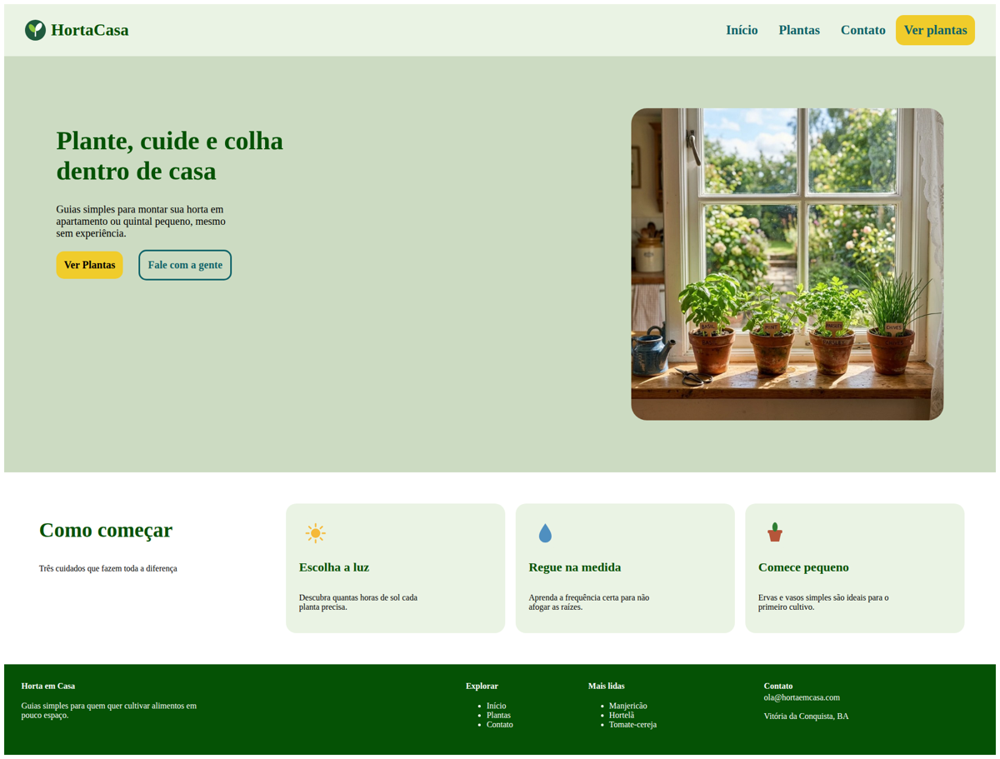
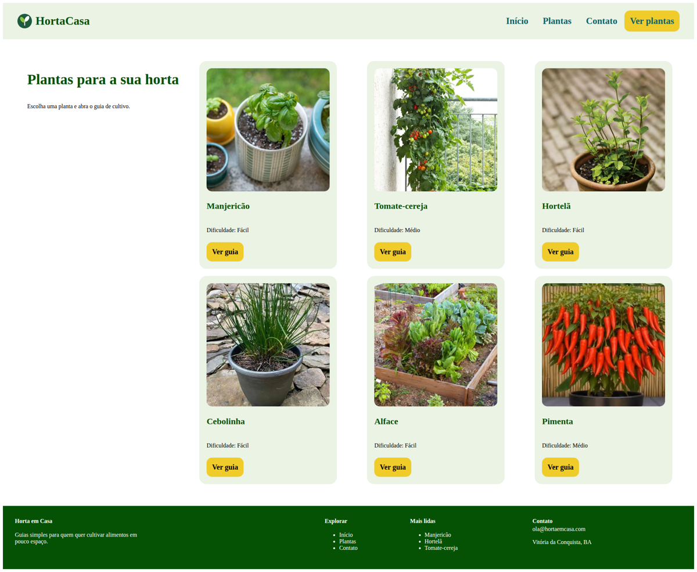
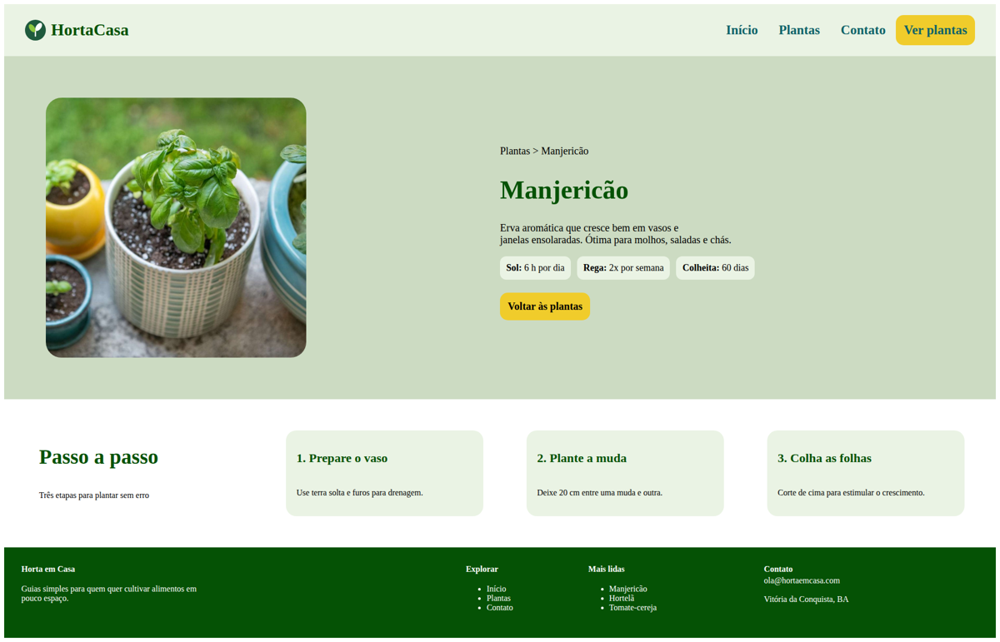
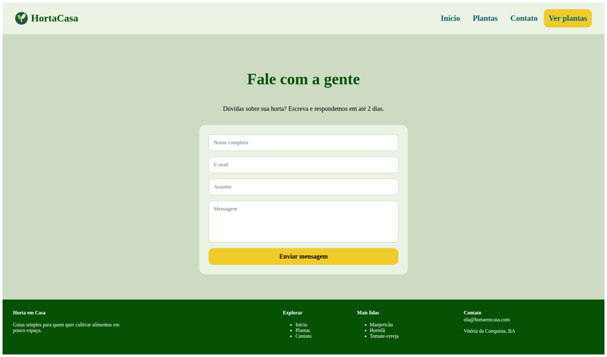
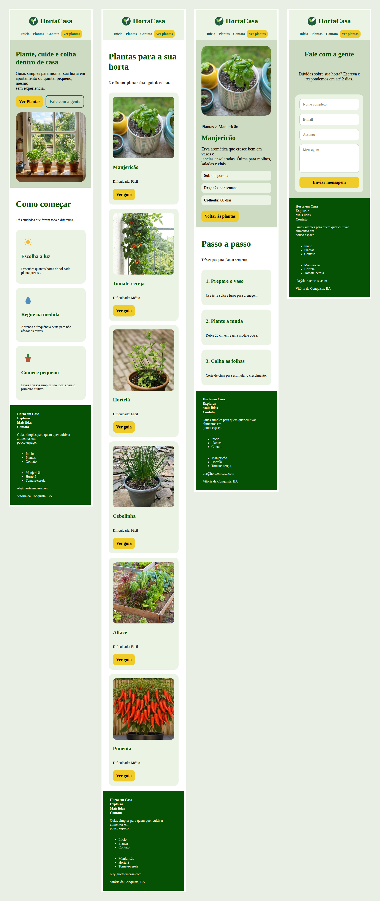

## HortaCasa

*Horta em Casa — Plante, cuide e colha dentro de casa.*

## Sobre a equipe

- Nome do projeto: **Horta em Casa (HortaCasa)**
- Integrantes da equipe: **Thiago S. Moreira** e **Gabriel Santos Prates**
- Instituição: **SENAI Bahia** (Vitória da Conquista, BA)
- Curso e turma: **Informática para Internet / 2º Ano D**
- Professor responsável: **Josué**

## Apresentação do Projeto

O HortaCasa é um site responsivo de 4 páginas, desenvolvido com versões adaptadas para Web (desktop) e Mobile (dispositivos móveis), voltado para o ensino prático de cultivo doméstico.

Nosso principal objetivo é *ensinar usuários iniciantes a plantar, cuidar e colher ervas, temperos e hortaliças dentro de casa* por meio de guias simples, visuais e organizados em passo a passo.

**Qual problema ele busca resolver?** Para quem está começando, iniciar uma horta em casa costuma parecer difícil devido a três barreiras principais:

| Barreira | Descrição |
| --- | --- |
| Pouco espaço | Moradores de apartamentos e quintais pequenos precisam de soluções adaptadas para vasos e janelas. |
| Falta de experiência | Iniciantes não sabem por onde começar nem quais espécies são mais adequadas para o cultivo doméstico. |
| Dúvidas sobre luz e rega | Incerteza sobre a quantidade ideal de exposição solar e frequência de rega sem prejudicar ou afogar as raízes das plantas. |

**Por que esse projeto foi desenvolvido?** Para atender à necessidade de um guia acessível e direto ao ponto, permitindo que qualquer pessoa — mesmo sem experiência prévia e com espaço reduzido — consiga cultivar seus próprios alimentos sem erros.

## Funcionalidades

*Navegação entre páginas* — Menu superior com links diretos para Início, Plantas e Contato, além de botões de chamada para ação (Ver plantas e Fale com a gente) distribuídos pelas telas.

*Catálogo de plantas* — Exibição de seis espécies de plantas organizadas em cartões individuais, apresentando foto, nome, nível de dificuldade de cultivo (ex.: Fácil, Médio) e botão Ver guia.

*Guia de cultivo detalhado* — Página dedicada à planta selecionada contendo resumo informativo, requisitos de exposição ao sol, frequência de rega, tempo estimado até a colheita e um tutorial passo a passo em três etapas.

*Formulário de contato* — Interface na página Contato com quatro campos (Nome completo, E-mail, Assunto e Mensagem) e botão de envio, informando o prazo de retorno de até 2 dias.

*Design Responsivo (Web e Mobile)* — Adaptação automática do layout conforme o tamanho da tela: no desktop, o menu é horizontal e os cartões ficam lado a lado; no celular, o logotipo e o menu são centralizados, as imagens ocupam largura total, os cartões são empilhados em coluna única e os botões são redimensionados para facilitar o toque.

## Tecnologias Utilizadas

| Tecnologia | Para que foi usada |
| --- | --- |
| HTML5 | Estruturação semântica das 4 páginas do site e do formulário de contato |
| CSS3 | Estilização visual, paleta de cores, tipografia e responsividade para versões Web e Mobile |
| SVG e JPG | Imagens vetoriais (ícones e logotipo) e matriciais (fotografias das plantas e banner principal) |
| Visual Studio Code | Editor de código utilizado no desenvolvimento |
| Git e GitHub | Controle de versão e hospedagem do código-fonte |

## Estrutura do Projeto

Na pasta principal **horta-em-casa/** ficam as páginas do site:

- lp.html — Página inicial (Landing Page) com apresentação e chamadas para ação
- plantas.html — Página com o catálogo das 6 plantas em cartões
- detalhes.html — Página com o guia detalhado e passo a passo de cultivo da planta
- contato.html — Página com o formulário de contato

Dentro da pasta **assets/** ficam os recursos visuais:

- logo.svg — Logotipo oficial do HortaCasa
- hero.jpg — Imagem de destaque da página inicial
- icone-agua.svg, icone-sol.svg e icone-vaso.svg — Ícones ilustrativos de rega, exposição solar e cultivo em vaso
- alface.jpg, cebolinha.jpg, hortela.jpg, manjericao.jpg, pimenta.jpg e tomate.jpg — Fotografias das plantas

## Como Executar o Projeto?

Por se tratar de uma aplicação front-end estática, não é necessária a instalação de servidores ou bancos de dados complexos.

Baixe os arquivos pelo [GitHub](https://github.com/SEU-USUARIO/horta-em-casa) (em *Code > Download ZIP*) e extraia a pasta horta-em-casa, ou clone o projeto pelo terminal com ```git clone https://github.com/SEU-USUARIO/horta-em-casa.git```. Depois, acesse a pasta horta-em-casa no seu computador e dê um duplo clique no arquivo **lp.html** para abri-lo em qualquer navegador moderno (Google Chrome, Microsoft Edge, Firefox, etc.).

Se preferir, abra a pasta no Visual Studio Code e utilize a extensão *Live Server* para visualizar o projeto.

## Demonstração do Projeto

**Web (Desktop)**



Página inicial (lp.html) exibindo o menu horizontal, chamada principal e botões de ação lado a lado com a fotografia ilustrativa.



Página Plantas (plantas.html) apresentando o catálogo em grade com os cartões das espécies e seus respectivos níveis de dificuldade.



Página Guia de cultivo (detalhes.html, exemplo: Manjericão) detalhando tempo de sol, frequência de rega e prazo de colheita.



Página Contato (contato.html) contendo os quatro campos de preenchimento e o botão para envio de dúvidas.

**Mobile (Celular)**



Adaptação responsiva das telas Início, Plantas, Guia de cultivo e Contato para smartphones, com menu centralizado, cartões em coluna única e botões ampliados para toque.

---

## Melhorias Futuras

- Sistema de busca e filtros no catálogo, com barra de pesquisa e filtros por nível de dificuldade (Fácil, Médio) ou necessidade de luz solar na página plantas.html.
- Calculadora e lembretes de rega em JavaScript, para o usuário cadastrar suas plantas e receber alertas visuais ou notificações sobre o momento certo de regar.
- Integração de back-end no formulário da página contato.html, com envio de e-mails ou banco de dados para armazenar e responder às mensagens reais dos usuários.
- Expansão do catálogo de espécies, com novas categorias além das seis plantas atuais (alface, cebolinha, hortelã, manjericão, pimenta e tomate-cereja).
